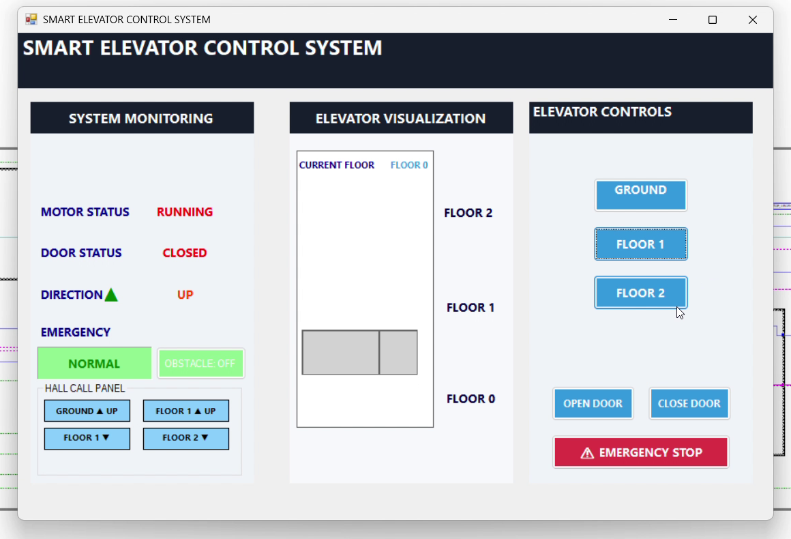
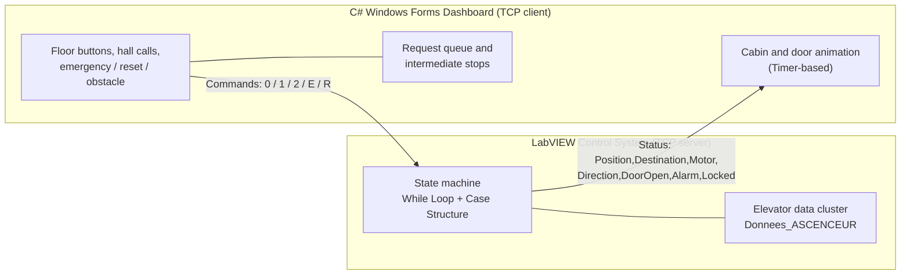
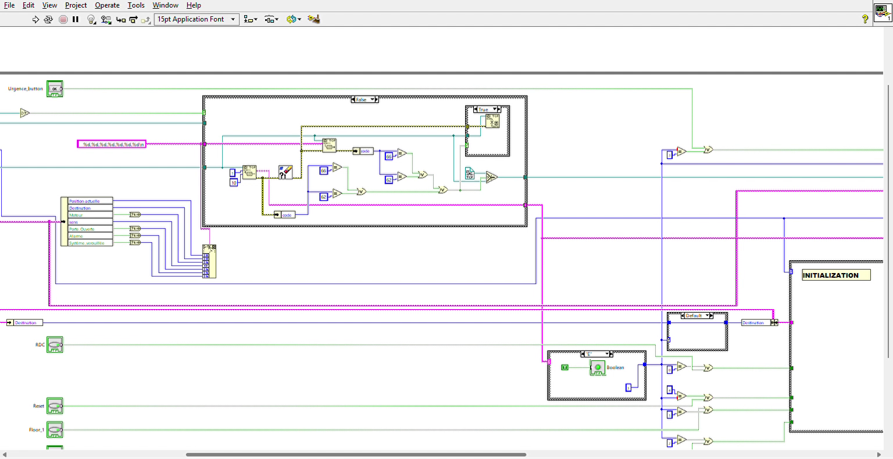
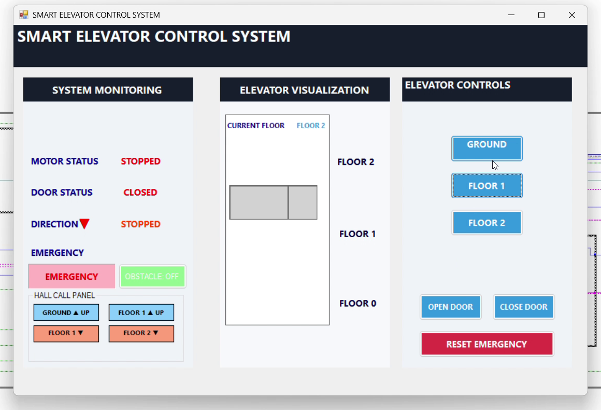
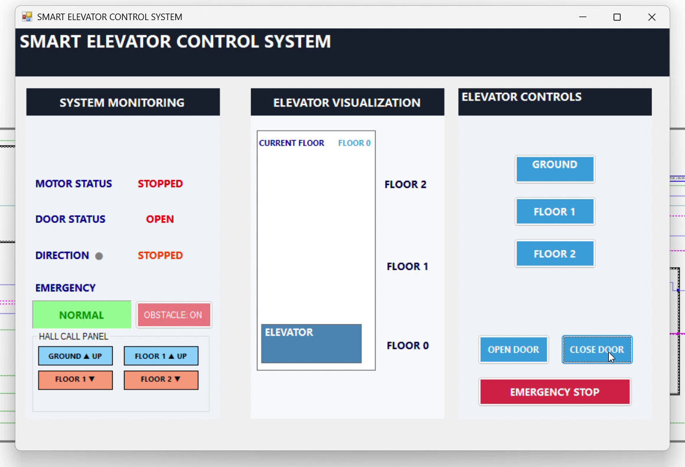
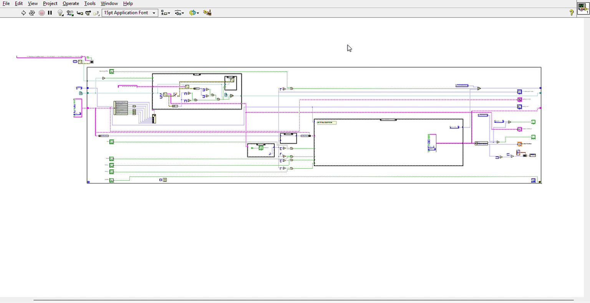
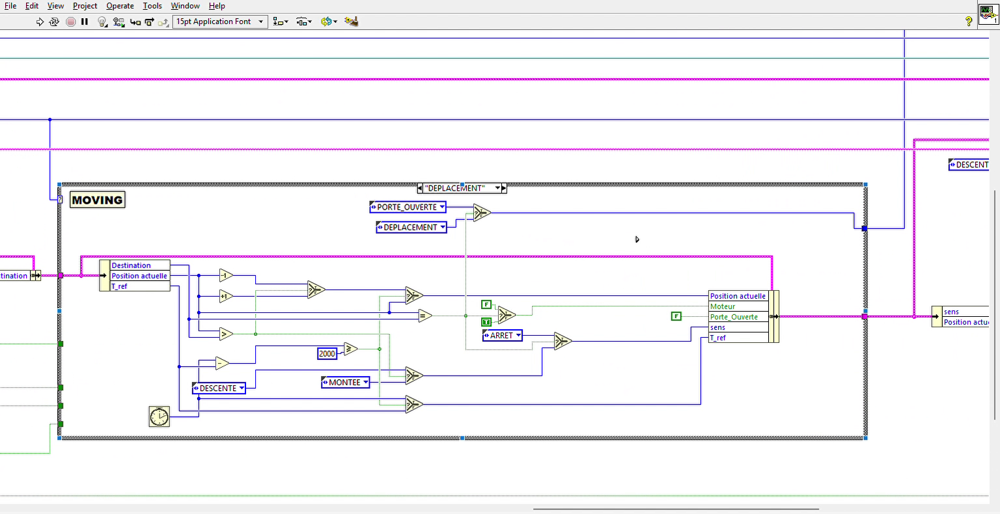

# Smart Elevator Control and Monitoring System


A software-based elevator simulation and monitoring application that integrates **LabVIEW** and a **C# Windows Forms** dashboard through **bidirectional TCP/IP communication**.

LabVIEW handles the control logic, state management and operational decisions. The C# application provides an interactive dashboard to control and monitor a three-floor elevator, including cabin movement, door operation, floor requests, direction management and emergency handling.

> 🎥 **Demo video:** [`Media/Smart_Elevator_Demo.mp4`](Media/Smart_Elevator_Demo.mp4)



---

## Table of Contents

1. [Project Objectives](#project-objectives)
2. [System Architecture](#system-architecture)
3. [Main Features](#main-features)
4. [Technologies and Tools](#technologies-and-tools)
5. [LabVIEW and C# Integration](#labview-and-c-integration)
6. [TCP/IP Communication Architecture](#tcpip-communication-architecture)
7. [Project Folder Structure](#project-folder-structure)
8. [Installation and Execution](#installation-and-execution)
9. [Screenshots and Demonstration](#screenshots-and-demonstration)
10. [Future Improvements](#future-improvements)

---

## Project Objectives

The main objective is to demonstrate the integration of industrial control programming with modern desktop application development. The project demonstrates practical skills in:

- State-machine design and industrial control logic
- Event-driven programming
- Desktop graphical interface development
- TCP/IP client-server communication and real-time data exchange
- Software integration between two development environments
- Error and connection management
- Simulation and monitoring systems

---

## System Architecture

The system consists of two applications that communicate over TCP/IP on the local machine.



### A. LabVIEW: Elevator Control System

The control logic was originally developed in LabVIEW 2015 and later maintained and improved in LabVIEW 2026. It uses a **state-machine architecture** built with a While Loop, a Case Structure, Shift Registers, Enum-based state selection and cluster-based data management.

| State | Role |
|---|---|
| `INIT` | Initializes the elevator system |
| `ATTENTE` | Waits for user requests (idle) |
| `DEPLACEMENT` | Controls elevator movement |
| `PORTEOUVERTE` | Manages the open-door state |
| `PORTEFERMEE` | Manages the closed-door state |
| `STOP_URGENT` | Handles emergency situations |

Elevator data is grouped in the `Donnees_ASCENCEUR` cluster:

| Variable | Description |
|---|---|
| Position actuelle | Current elevator floor |
| Destination | Requested destination floor |
| Moteur | Motor operating status |
| Sens | Movement direction |
| Porte ouverte | Door-open status |
| Porte fermée | Door-closed status |
| Alarme | Emergency alarm status |
| Système verrouillée | System lock status |
| T_ref | Reference time used for timing operations |

Direction enum: `0` = ARRET (stopped), `1` = MONTEE (up), `2` = DESCENTE (down).
Floors: `0` = ground, `1` = first floor, `2` = second floor.

### B. C#: Graphical Monitoring Dashboard

Developed with C# Windows Forms in Visual Studio. The cabin moves smoothly between floors using a Windows Forms `Timer`. The dashboard displays the current operating condition, direction and movement status.

---

## Main Features

- Three-floor elevator simulation
- Floor selection through the dashboard and through LabVIEW controls
- Upward and downward hall-call buttons
- Direction-aware request handling and **intermediate floor stops**
- Request queue management
- Animated cabin movement and animated door opening/closing
- Direction indicators, motor status, current floor and door status
- **Emergency stop and reset**
- **Obstacle detection simulation**
- Real-time status exchange between LabVIEW and C#
- Connection validation, timeout handling and error handling

---

## Technologies and Tools

| Technology | Purpose |
|---|---|
| LabVIEW 2015 / 2026 | Elevator control logic and state machine |
| C# | Application development |
| Windows Forms | Graphical dashboard |
| Visual Studio | C# development environment |
| TCP/IP (TCP Read / TCP Write) | Communication between LabVIEW and C# |
| System Exec.vi | Automatic dashboard launching |
| Timers | Cabin and door animations |
| Enum and Cluster | State and data management |

---

## LabVIEW and C# Integration

LabVIEW and C# each do what they are best suited for:

- **LabVIEW** owns the control logic. It receives requests, runs them through the state machine and decides how the elevator behaves.
- **C#** owns the user experience. It sends the user's actions to LabVIEW and renders the elevator's state received back.

LabVIEW can launch the C# executable automatically when the VI starts, using `System Exec.vi` in a non-blocking way. Requests coming from the dashboard are merged with the existing physical-button logic of the LabVIEW state machine. The intended final presentation uses the C# dashboard as the main visible interface, with LabVIEW running in the background.

---

## TCP/IP Communication Architecture

| Parameter | Value |
|---|---|
| LabVIEW role | TCP server |
| C# role | TCP client |
| Address | `127.0.0.1` (localhost) |
| Port | `5000` |
| Direction | Bidirectional |

**C# → LabVIEW (commands)**

| Command | Function |
|---|---|
| `0` | Request ground floor |
| `1` | Request first floor |
| `2` | Request second floor |
| `E` | Emergency stop |
| `R` | Reset |

**LabVIEW → C# (status)**: seven comma-separated values:

```
Position,Destination,Motor,Direction,DoorOpen,Alarm,Locked
```

The message is built with LabVIEW's *Format Into String* and sent with *TCP Write*. The C# application parses the values and updates the dashboard.

The LabVIEW implementation includes TCP listener initialization, client connection management, connection ID management with shift registers, connection validation, timeout handling, connection-error detection, and closing/resetting the connection after a disconnection.

See [`Documentation/Communication_Protocol.md`](Documentation/Communication_Protocol.md) for details.



---

## Project Folder Structure

```
Smart-Elevator-Control-Monitoring-System/
├── LabVIEW/            # LabVIEW project: Smart_Elevator_TCP.vi and supporting VIs
├── CSharp/             # C# Windows Forms solution and source code
├── Documentation/      # Protocol description and project documentation
├── Media/
│   ├── Screenshots/    # Dashboard and block diagram screenshots
│   └── Smart_Elevator_Demo.mp4
├── README.md
├── .gitignore
└── .gitattributes
```

---

## Installation and Execution

### Requirements

- Windows
- LabVIEW (the project was developed in 2015 and maintained in 2026; use a version able to open the saved VIs)
- Visual Studio with the .NET desktop development workload

### Steps

1. **Build the C# dashboard.** Open the solution in `CSharp/` with Visual Studio and build it. The build output (`bin/`, `obj/`) is not stored in this repository.
2. **Check the dashboard path in LabVIEW.** The VI launches the dashboard with `System Exec.vi`. Make sure the executable path used in the block diagram points to your freshly built executable.
3. **Run the LabVIEW VI.** Open `Smart_Elevator_TCP.vi` from `LabVIEW/` and run it. It starts the TCP server on port `5000` and launches the dashboard.
4. **Use the dashboard.** The C# client connects to `127.0.0.1:5000`. Select floors, use the hall-call panel, try *Emergency Stop* / *Reset Emergency*, and simulate an obstacle.

> If the dashboard does not launch automatically, start the built executable manually after the VI is running (the server must be listening first).

---

## Screenshots and Demonstration

**Demo video:** [`Media/Smart_Elevator_Demo.mp4`](Media/Smart_Elevator_Demo.mp4) (about 45 seconds: block diagram, then dashboard).

| Dashboard: emergency stop | Dashboard: obstacle detection |
|---|---|
|  |  |

| LabVIEW: block diagram overview | LabVIEW: state machine |
|---|---|
|  |  |

---

## Future Improvements

- Integration with a physical elevator prototype
- Real sensors and motor controllers
- More advanced safety mechanisms
- Improved communication reliability
- More detailed real-time monitoring
- Historical data logging
- Remote monitoring capabilities
- Enhanced dashboard design

---

## Author

Oumaima Cherieg Mednini: www.linkedin.com/in/
oumaima-cherieg-mednini-79a46421b

